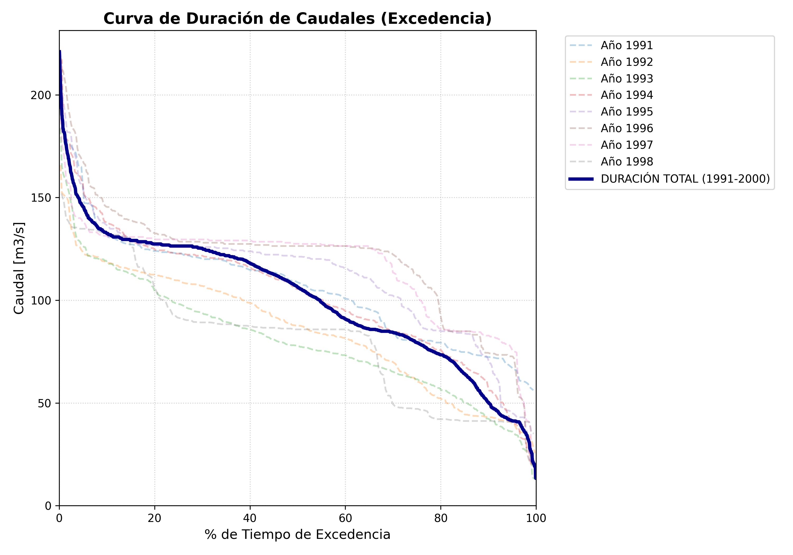
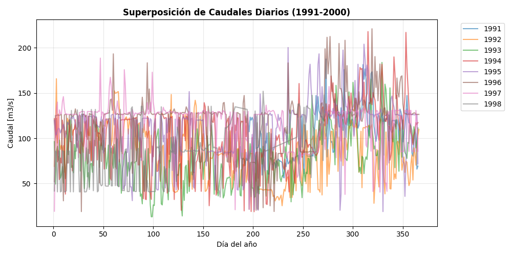
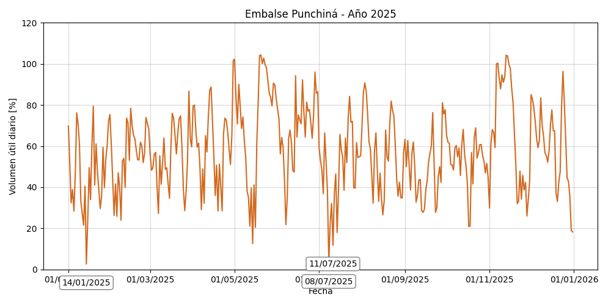
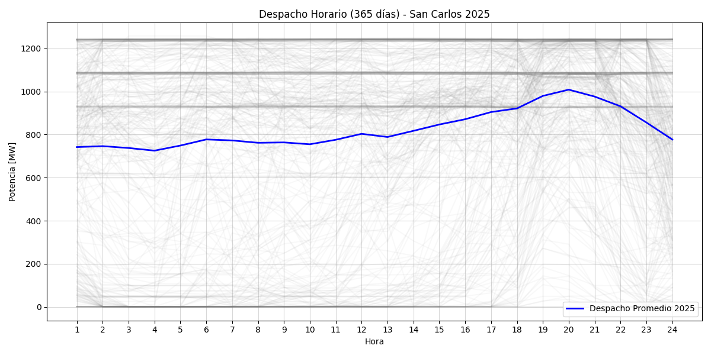

# Power Grid Dispatch & Hydrological Energy Analytics
### *Operational Dispatch, Inflow Exceedance & Reservoir Dynamics for Central San Carlos (1,240 MW)*

[](https://www.python.org/)
[](https://pandas.pydata.org/)
[]()
[-purple.svg)]()

---

## Executive Summary

This repository contains an engineering framework developed in **Python** to analyze utility-scale power dispatch, hydrological inflow distributions, and reservoir storage dynamics for **Central Hidroeléctrica San Carlos (1,240 MW installed capacity)**, one of the largest dispatchable firm-energy assets in the Colombian National Interconnected System (SIN).

Using official market and operational datasets from **XM (System Operator & Wholesale Market Administrator)**, this project models:
1. **Flow Duration Curves (FDC) & Exceedance Probabilities** ($Q_{\text{max}}, Q_{10} \dots Q_{95}$) across multi-year historical inflow time-series.
2. **Hourly Generation Dispatch Unrolling & Plant Capacity Factor ($CF$) Evaluation** from 24-hour block generation matrices.
3. **Reservoir Storage Dynamics & Spillway Monitoring** for Embalse Punchiná to assess hydrological risk and generation security.

---

## Engineering Methodology & Modules

### 1. Flow Exceedance & Hydrological Durations (`src/flow_duration_curves.py`)
* Computes non-parametric empirical percentile distributions for daily river inflows ($m^3/s$) across multi-year historical periods (Río Guatapé / San Carlos basin).
* Generates characteristic flow exceedance matrices ($Q_{\text{max}}, Q_{10}, Q_{20}, \dots, Q_{95}$) to evaluate firm discharge availability for turbine intake design.

```math
P(Q \ge q) = \frac{m}{n + 1} \times 100\%
```

### 2. Hourly Dispatch & Capacity Factor Modeling (`src/hourly_dispatch_analysis.py`)
* Unpivots 24-hour generation matrices ($kWh$) into continuous time-series in Megawatts ($MW$).
* Evaluates plant generation duration curves and calculates annual **Plant Capacity Factor ($CF$)**:

```math
CF = \frac{E_{\text{annual}} \text{ [MWh]}}{P_{\text{installed}} \text{ [MW]} \times 8,760 \text{ h}} \times 100\%
```

### 3. Reservoir Storage & Spillway Integration (`src/hydro_thermal_coordination.py`)
* Evaluates daily useful reservoir storage percentage ($\%$) in Embalse Punchiná against minimum technical operational thresholds.
* Correlates upstream inflows with spillway discharges ($m^3/s$) to assess energy spillage and operational dispatch margins during peak wet seasons.

---

## Visual Engineering Analytics

| Flow Duration Curve (Guatapé Basin) | Annual Inflow Superposition |
| :---: | :---: |
|  |  |

| Reservoir Storage Volume (%) | 365-Day Generation Dispatch Profiles |
| :---: | :---: |
|  |  |

---

## Repository Structure

```text
power-grid-dispatch-analytics/
├── assets/                          # Generated engineering figures & duration plots
│   ├── Curva_Excedencia_Guatape.png
│   ├── 1_Superposicion_Anual.png
│   ├── Punto_10_Reservas.png
│   └── Punto_14_Curvas_365.png
├── data/                            # Operational & hydrological Excel datasets
│   ├── Aportes_Historicos.xlsx      # Historical daily inflow records (1991-1998)
│   ├── Generacion_San_Carlos_2025.xlsx # 24-hr hourly generation matrix (XM)
│   ├── Reservas_Diario_2025.xlsx    # Punchina reservoir storage telemetry
│   └── Vertimentos_Diario_2025.xlsx # Spillway discharge telemetry
├── src/                             # Python engineering modules
│   ├── flow_duration_curves.py      # FDC and characteristic quantile modeling
│   ├── hourly_dispatch_analysis.py  # Dispatch unpivoting and Capacity Factor engine
│   └── hydro_thermal_coordination.py# Reservoir balance and inflows aggregation
├── .gitignore
├── requirements.txt
└── README.md
```

---

## Quickstart & Reproduction

### Prerequisites
* Python 3.10 or higher.

### 1. Clone the repository
```bash
git clone https://github.com/<your-username>/power-grid-dispatch-analytics.git
cd power-grid-dispatch-analytics
```

### 2. Install dependencies
```bash
pip install -r requirements.txt
```

### 3. Run Analysis Modules

**Compute Flow Duration Curve Exceedance Percentiles:**
```bash
python src/flow_duration_curves.py
```

**Run Hourly Dispatch & Capacity Factor Calculation:**
```bash
python src/hourly_dispatch_analysis.py
```

---

## Author

**Andrés Felipe Maestre Badillo**  
*Energy & Sustainability Engineering (B.S. Candidate, 2027) | Minor in Data Science*  
*Universidad Autónoma de Bucaramanga (UNAB)*  
*Bucaramanga, Colombia*  
[LinkedIn Profile](https://www.linkedin.com/in/) | [Email](mailto:afmae556@gmail.com)

